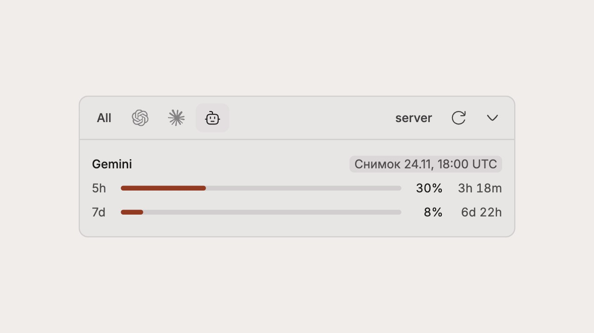

# Gemini Quota

See Antigravity’s five-hour and weekly Gemini quota in BB’s built-in Provider Usage panel.

## Requirements

Use BB 0.50 or later with plugin SDK 0.6.157. The integration was tested with Antigravity CLI 1.5.16 on a Linux host. The parser expects the English `/usage` screen. Install and sign in to Antigravity on the host that BB will query. You may need a Google AI plan that includes the quota windows shown in Antigravity.

## Set up

1. Open a dedicated terminal in a trusted workspace on that host. Find its ID with `bb terminal list --thread <thread_id>`.
2. Set the terminal ID with `bb plugin config gemini-quota set terminalId <term_id>`.
3. If Antigravity is installed in a different directory than the default, set its absolute path on the terminal host with `bb plugin config gemini-quota set agyPath /path/to/agy`. The default is `.local/bin/agy` under the BB server account’s home directory. Set `agyPath` explicitly when your BB server and terminal host use different home directories.
4. Select that host in Provider Usage and click **↻**.

## Refresh and local data

The button opens a temporary interactive terminal in the configured workspace, runs Antigravity’s `/usage` command, and closes the terminal. The dedicated terminal only supplies the host and workspace for this operation. If you leave its `/usage` screen open, BB reads the rendered screen once a minute. On refresh failure, the panel keeps the last successful snapshot and its timestamp. Reset times are estimates from the CLI countdown.

The plugin relies on the interactive CLI display and the session Antigravity already manages. It stores the percentages, approximate reset times, timestamp, and source information locally in BB. Google does not provide a public quota API for consumer plans. See the [Antigravity terms](https://antigravity.google/terms), the [Google quota integration guidance](https://discuss.ai.google.dev/t/tos-clarification-read-only-agy-p-usage-credits-from-acp-clients-or-native-quota-surface/203283), and the [CLI documentation for `/usage`](https://antigravity.google/docs/cli/commands/usage/).

## Development

Run `npm ci`, `npm test`, `npm run typecheck`, and `bb plugin build`.
